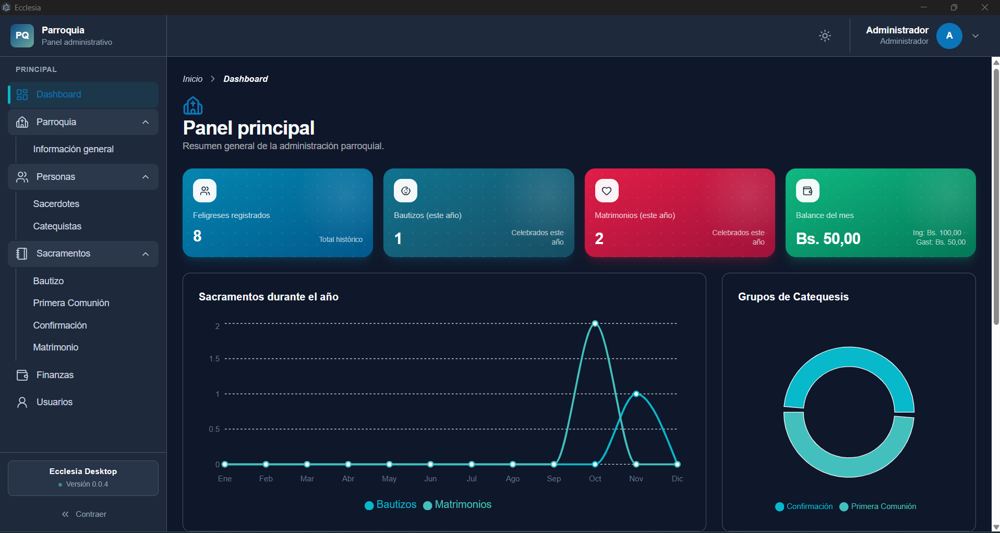
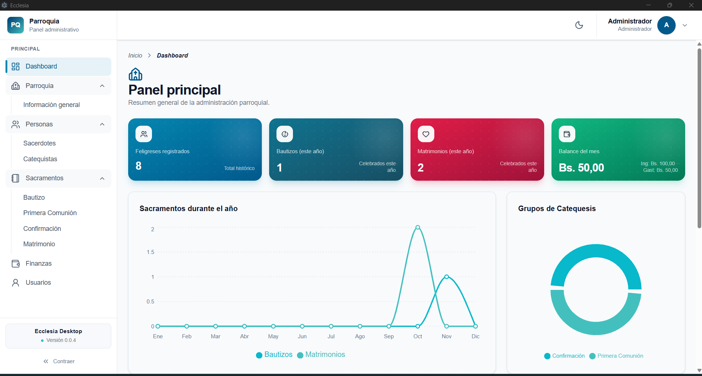

 

# ✨ Fidara

**Gestión parroquial con confianza.**

El sistema de escritorio definitivo para la gestión parroquial. Diseñado para funcionar de manera rápida, segura y <b>100% sin conexión a Internet</b>, cuidando la confidencialidad de los registros de tu parroquia.

<!-- Métricas y Estado del Proyecto -->

 

### [ 📥 Descargar la última versión para Windows ](https://github.com/ketopi/Ecclesia-Desktop-App/releases/latest)

Al instalar, Windows podría mostrar una advertencia de seguridad. Haz clic en "Más información" y luego en "Ejecutar de todas formas".

---

## 🧩 Módulos y Funcionalidades

Fidara está diseñado con una arquitectura modular para cubrir todas las áreas críticas de la parroquia:

### 📊 Panel de Control (Dashboard)
- **Estadísticas en tiempo real:** Resumen visual de feligreses, sacramentos del año y balance financiero.
- **Gráficas interactivas:** Historial anual de sacramentos (Bautizos, Comuniones, Confirmaciones y Matrimonios) y distribución de grupos de catequesis.
- **Actividad Reciente:** Panel de últimos movimientos y próximos eventos programados.

### 🏛️ Gestión de la Parroquia
- **Datos Institucionales:** Configuración de la parroquia, jurisdicción, datos de contacto y párroco actual.
- **Sacerdotes:** Registro de ministros ordenados con sus tratamientos eclesiásticos.
- **Catequistas:** Directorio de catequistas activos.

### 👥 Feligreses y Personas
- **Base de Datos Central:** Registro unificado de personas (con foto, contacto y fecha de nacimiento) para evitar duplicidad de datos.
- **Feligreses:** Vinculación de personas a la comunidad parroquial.

### 🕊️ Sacramentos
- **Bautizos:** Registro completo con libro, folio, acta, datos de padres y padrinos.
- **Matrimonios:** Registro detallado con datos de los contrayentes, testigos, parroquia de celebración y acta.
- **Catequesis (Primera Comunión y Confirmación):** Creación de grupos, asignación de catequistas, inscripción y control de actas de sacramento individuales.

### 📜 Generación de Certificados
- **Documentos Oficiales:** Generación de certificados en PDF con formato oficial (A4/Carta, bordes, firmas y sello) para todos los sacramentos.
- **Impresión Masiva:** Generación de certificados grupales para entregar a todos los alumnos de un grupo en un solo PDF.

### 💰 Gestión Financiera
- **Control de Caja:** Registro de ingresos y gastos con categorías y comprobantes.
- **Soporte Multi-moneda:** Manejo de montos con tipo de cambio.
- **Adjuntar Comprobantes:** Almacenamiento local seguro de imágenes o PDFs de facturas.

### 🛡️ Seguridad y Respaldo (Backup & Restore)
- **Copias de Seguridad:** Exportación de toda la base de datos y comprobantes en un archivo `.zip` seguro y cifrado.
- **Restauración:** Recuperación total del sistema en caso de fallos o migración de equipos.
- **Roles de Usuario:** Control de acceso para Administradores y Secretarios.

---

## 🚀 Evolucionando la gestión parroquial

Fidara nace con una visión:

> "Llevar la organización parroquial a una nueva etapa mediante tecnología simple, moderna y accesible."

Una herramienta pensada para facilitar el trabajo administrativo y ofrecer una experiencia agradable a quienes dedican su tiempo al servicio de la comunidad.

---

## 👤 Desarrollado por

**KETOR Technologies**  
Kevin Torrez Pillco

💬 ¿Necesitas soporte o más información?  
[Contactar por WhatsApp](https://wa.me/59164892528)

---

  Fidara — Confianza que se nota en cada registro.

